# 🍕 Pizza Sales Analysis Using SQL (MySQL)

## 📌 Project Overview

This project focuses on analyzing pizza sales data using MySQL to identify business trends, customer ordering patterns, product performance, and revenue contribution.

The objective is to transform raw sales data into meaningful business insights that can help stakeholders understand sales performance and make data-driven decisions.

## 🎯 Business Objectives

- Analyze total orders and overall revenue.
- Identify the highest-priced pizza.
- Understand customer preferences by pizza size.
- Find the most popular pizzas based on quantity sold.
- Analyze category-wise pizza sales and revenue contribution.
- Identify peak ordering hours.
- Track cumulative revenue over time.
- Identify top revenue-generating pizza types.

## 🛠️ Tools & Technologies

- **Database:** MySQL
- **Query Language:** SQL
- **Analysis:** Aggregations, Joins, Subqueries, Window Functions
- **Documentation:** GitHub

## 📊 Key Business Findings

| Business Metric | Result |
|---|---:|
| Total Orders | 4,391 |
| Total Revenue | $87,874.30 |
| Highest-Priced Pizza | The Greek Pizza ($35.95) |
| Most Common Pizza Size | Large |
| Top-Selling Pizza | Pepperoni |
| Highest Revenue Pizza | BBQ Chicken |

### Additional Insights

- Large pizzas represent the most common size in the size distribution.
- Classic pizzas contribute the highest share of category revenue at 26.57%.
- 12 PM records the highest order volume with 524 orders.
- BBQ Chicken generates the highest revenue among the top three pizza types.
- Cumulative revenue reached $45,763.65 by January 20, 2015.

## 📈 SQL Analysis & Business Questions

The project answers business questions across the following areas:

1. Total number of orders.
2. Highest-priced pizza.
3. Most common pizza size.
4. Top 3 most ordered pizza types.
5. Category-wise pizza quantity.
6. Hourly order distribution.
7. Number of pizza varieties in each category.
8. Category-wise revenue contribution.
9. Cumulative revenue over time.
10. Top 3 pizzas by revenue.
11. Total revenue generated.

## 💡 Business Value

The analysis helps stakeholders:

- Understand which pizza products drive sales and revenue.
- Identify peak ordering hours for operational planning.
- Evaluate category-wise revenue performance.
- Understand product demand and customer preferences.
- Support data-driven sales and inventory decisions.

## 📸 Project Screenshots

### Project Introduction
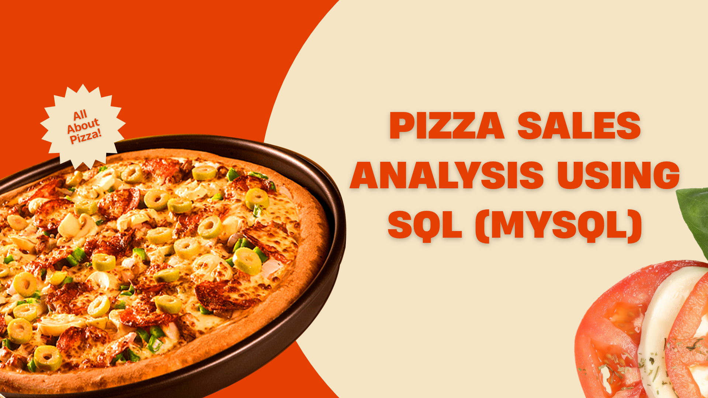

### Project Overview
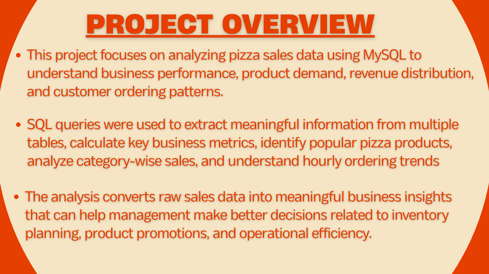

### Business Metrics
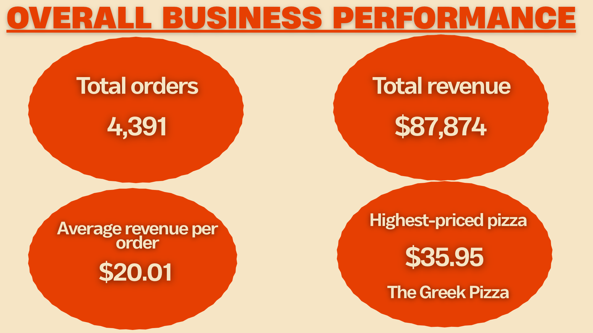

### SQL Analysis Results

#### 1. Total Orders
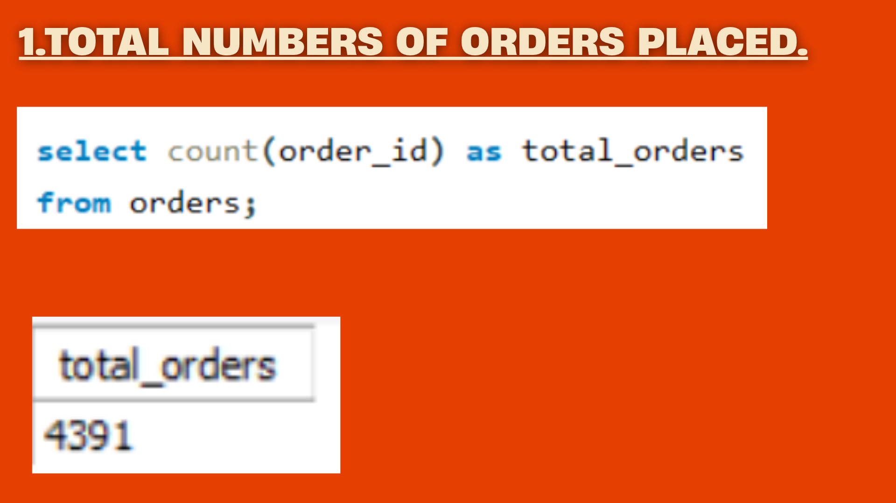

#### 2. Total Revenue
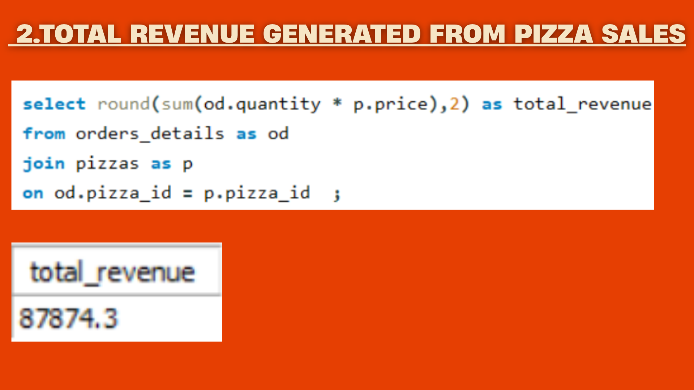

#### 3. Highest-Priced Pizza
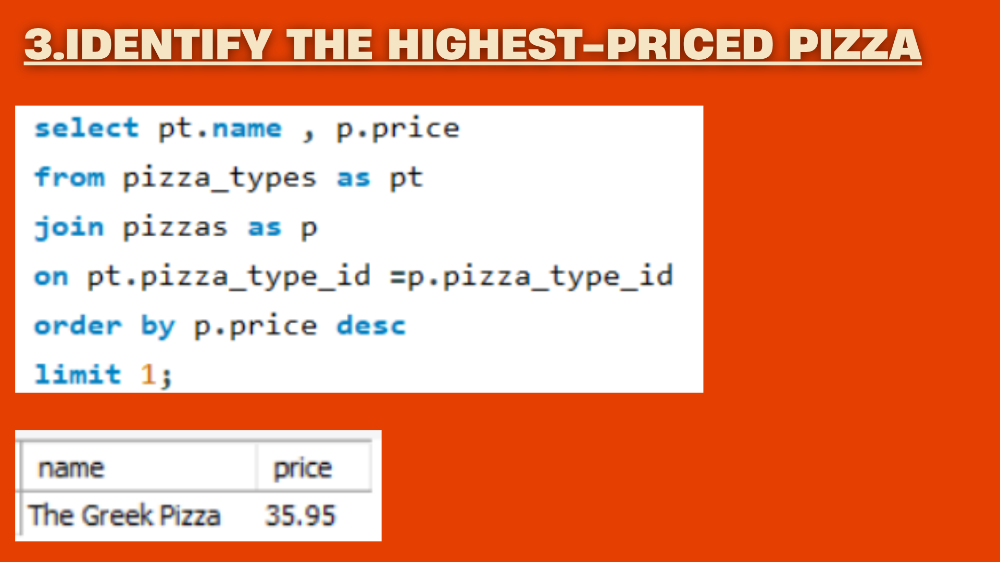

#### 4. Most Common Pizza Size
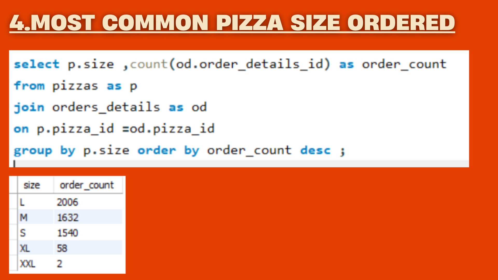

#### 5. Top 3 Most Ordered Pizzas
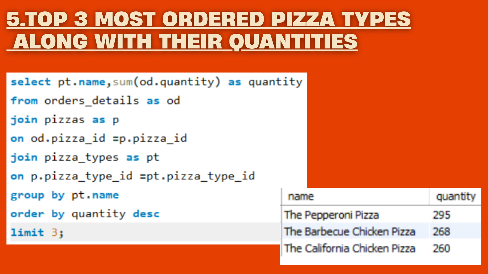

#### 6. Category-wise Pizza Quantity
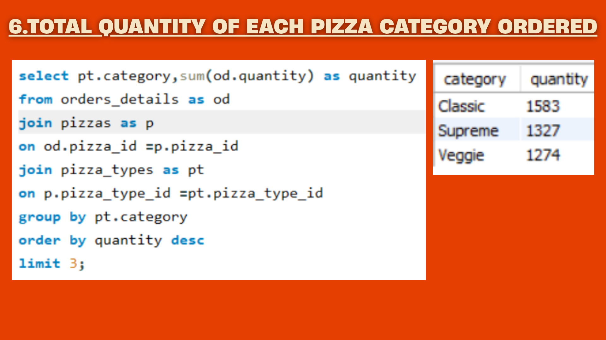

#### 7. Hourly Order Distribution
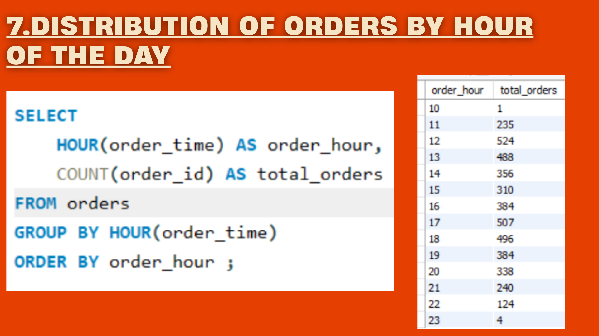

#### 8. Category-wise Pizza Variety
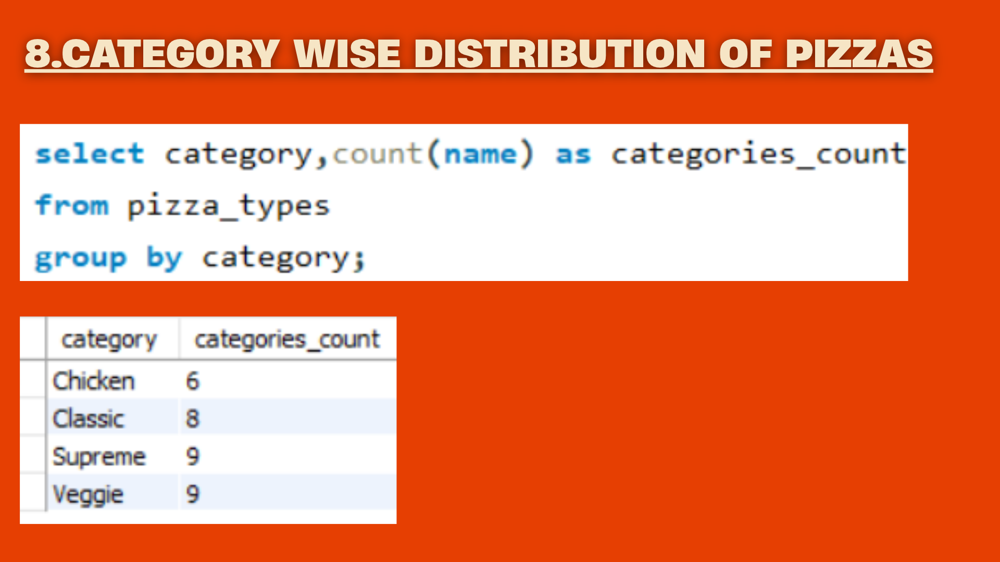

#### 9. Category-wise Revenue Contribution
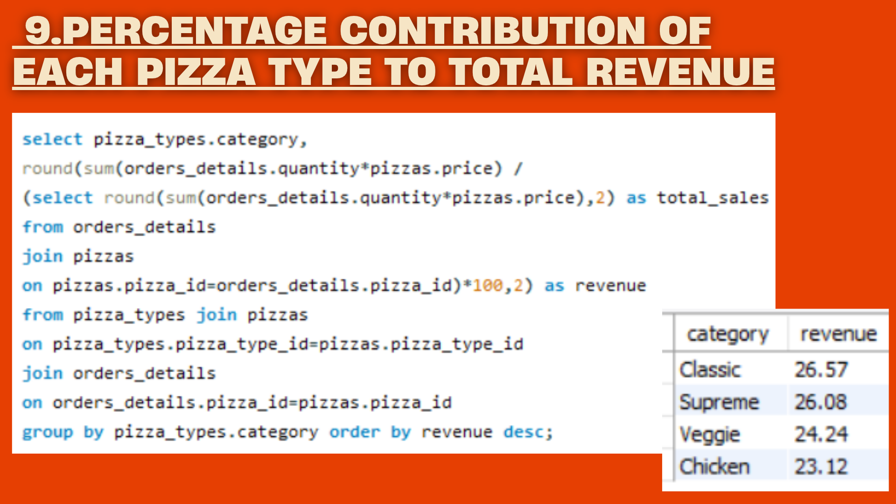

#### 10. Cumulative Revenue
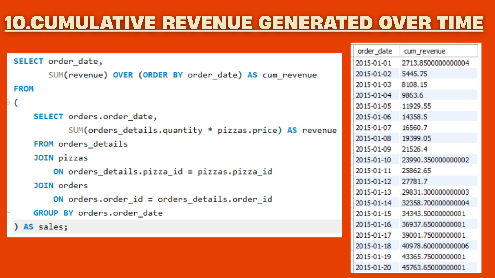

#### 11. Top 3 Pizzas by Revenue
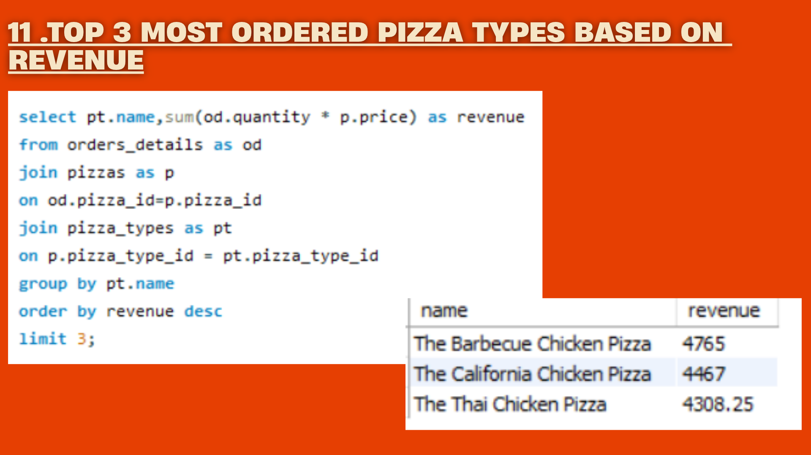

### Business Insights
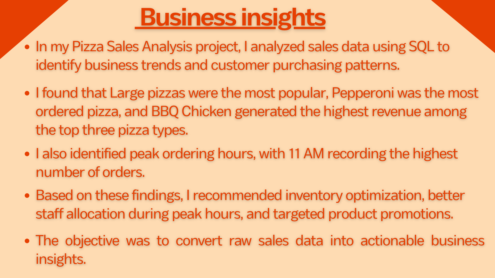

#### Thank You

## 📚 Skills Demonstrated

- SQL Data Analysis
- Data Aggregation
- GROUP BY and HAVING
- ORDER BY and LIMIT
- Subqueries
- Window Functions
- Cumulative Revenue Analysis
- Business Insight Generation
- Data Interpretation

## 👨‍💻 Author

**Altamash Sayyed**

Aspiring Data Analyst | SQL | Python | Pandas | Excel | Power BI
    

